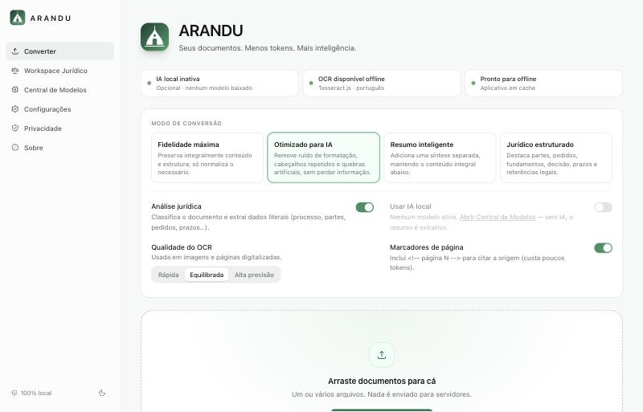

<p align="center">
  
</p>

<h1 align="center">ARANDU</h1>
<p align="center"><strong>Seus documentos. Menos tokens. Mais inteligência.</strong></p>
<p align="center">Converta PDF, DOCX, ODT, RTF, TXT e imagens em Markdown otimizado para IA — com OCR e análise jurídica, 100% no seu dispositivo.</p>

<p align="center">
  <a href="https://oliveiracarlosadv.github.io/Arandu/app/"></a>
</p>

<p align="center">
  <a href="https://oliveiracarlosadv.github.io/Arandu/">Página do projeto</a> ·
  <a href="#como-usar">Como usar</a> ·
  <a href="#desenvolvimento">Documentação</a> ·
  <a href="#licença">Licença MIT</a> ·
  <a href="#criador">Criador</a>
</p>

<p align="center"></p>

---

## O que é

O **ARANDU** (do guarani, *conhecimento, sabedoria*) é um aplicativo web instalável (PWA), gratuito e de código aberto, que transforma documentos em **Markdown estruturado e enxuto**, pronto para ser lido por modelos de IA (ChatGPT, Claude, Gemini, Llama…), sem enviar seus arquivos a nenhum servidor.

- **Privacidade absoluta:** todo o processamento ocorre no navegador (WebAssembly + Web Workers). Sem upload, sem APIs pagas, sem telemetria.
- **Menos tokens:** remove ruído de formatação, cabeçalhos/rodapés repetidos, quebras artificiais e duplicações comprovadas, preservando números de processo, datas, valores e referências legais.
- **Fidelidade:** validação de integridade; se alguma entidade crítica se perder, a economia de tokens não é contabilizada.
- **Jurídico:** classificação de 22 tipos de peças/documentos brasileiros e extração literal de processo (CNJ), tribunal, vara, partes, advogados/OAB, pedidos, fundamentos, dispositivos legais, jurisprudência, valores, prazos e resultado. O que não constar do documento aparece como *“Não identificado no documento.”*

## Funcionalidades

| Recurso | Status |
|---|---|
| PDF com texto, PDF digitalizado e PDF híbrido (OCR automático por página) | ✅ |
| DOCX, ODT, RTF, TXT | ✅ |
| Imagens PNG, JPG, WEBP, TIFF (multipágina) com OCR em português | ✅ |
| Qualidade de OCR: rápida, equilibrada, alta precisão (contraste, binarização Otsu, correção de orientação) | ✅ |
| 4 modos: Fidelidade máxima · Otimizado para IA · Resumo inteligente · Jurídico estruturado | ✅ |
| Métricas: caracteres, tokens estimados (o200k_base), redução, tempo, páginas, método, páginas com OCR | ✅ |
| Pré-visualização, edição, comparação bruto × otimizado | ✅ |
| Exportação: Markdown, TXT, JSON estruturado, ZIP do lote com índice | ✅ |
| Processamento em lote com progresso por arquivo, cancelamento e falhas isoladas | ✅ |
| Workspace Jurídico: processos, índice consolidado e cronologia com referência a arquivo/página | ✅ |
| Central de Modelos: IA local opcional (Qwen2.5 0.5B/1.5B via Transformers.js, WebGPU/WASM), download só com autorização | ✅ |
| PWA instalável e offline (após preparar os recursos) | ✅ |

## Como usar

1. Clique em **[ACESSE O ARANDU AQUI](https://oliveiracarlosadv.github.io/Arandu/app/)** (Chrome, Edge, Safari ou Firefox recentes). No primeiro acesso, uma apresentação explica o app e ensina a instalá-lo como aplicativo.
2. Escolha o **modo de conversão** e, se quiser, ative a **análise jurídica**.
3. Arraste documentos para a área de upload (ou clique em *Selecionar documentos*).
4. Acompanhe as etapas reais do processamento; ao final, revise, edite e **baixe** o Markdown, TXT, JSON ou o ZIP do lote.
5. Para PDFs digitalizados e imagens, o app pede autorização uma única vez para preparar o OCR (~13 MB, servido pelo próprio ARANDU).

## Desenvolvimento

Requisitos: Node.js 20+.

```bash
npm install        # instala dependências e copia OCR/ONNX para public/vendor
npm run dev        # servidor de desenvolvimento
npm test           # testes (Vitest)
npm run build      # build de produção (PWA) em dist/
npm run preview    # serve o build localmente
```

### Arquitetura

```
src/
  modules/
    pdf/        PDF.js: camada de texto + detecção de páginas digitalizadas
    docx/ odt/ rtf/ txt/   extratores determinísticos (com proteção contra zip bomb e macros)
    image/ ocr/ Tesseract.js (WASM) + pré-processamento em Canvas
    layout/     motor de layout: linhas → parágrafos, títulos, listas, tabelas, cabeçalhos repetidos
    markdown/   otimização, renderização GFM e validação de integridade
    legal/      classificador, extrator literal, decodificação CNJ (com dígito verificador)
    ai/         Transformers.js em Web Worker, catálogo de modelos, detecção de hardware
    tokens/     estimativa com tokenizer o200k_base
    batch/      pipeline, fila e exportações
    workspace/  processos, índice e cronologia
  pages/ components/ layouts/ services/ hooks/ workers/
```

Estratégia: extração determinística sempre que possível → OCR apenas quando necessário → IA local somente para resumo e verificação de classificação → Markdown → validação → download.

## Licença

- **Código:** [MIT](LICENSE).
- **Documentação e textos:** [CC BY 4.0](LICENSE-DOCS).
- **Nome, logotipo, ícones e fotografia:** todos os direitos reservados. Forks devem usar identidade visual própria.

Detalhes, atribuição e componentes de terceiros em [NOTICE.md](NOTICE.md). Modelos de IA seguem as licenças de seus autores (Qwen2.5: Apache-2.0).

## Criador

**Carlos Alexandre Albuquerque Oliveira**: advogado, empreendedor jurídico e pesquisador do Direito, de Belém do Pará, dedicado a criar soluções tecnológicas para a advocacia. Redes: @oliveiracarlosadv
